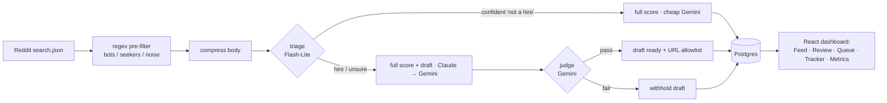

# Reddit Outreach — an AI pipeline for finding freelance dev gigs

Watches Reddit for people hiring developers, **scores** each post for fit (1–10),
**drafts** a personalized outreach message, and surfaces it in a review dashboard —
built as a **production-grade LLM pipeline**: evals, model routing, guardrails,
context engineering, observability, and a human-in-the-loop feedback loop.

> It's a real tool I use — but the point of the repo is the **AI engineering around
> the model**, not just "call an LLM."

---

## Why this repo is interesting (the AI engineering)

| Concern | What's here |
|---|---|
| **Evals** | Hand-labeled golden set + harness: precision/recall/F1, confusion matrix, Spearman, MAE, parse-failure rate, cost/latency. Prompt versions (`v1→v3`) are logged per call so results tie to the exact prompt. |
| **Model routing** | A cheap **Flash-Lite triage** decides "real paid dev-hire?"; confident cases route to a cheap full-score, promising ones to the stronger **Claude** tier — *route, never drop*, so a wrong triage can't silently kill a lead. |
| **Guardrails** | Output **URL allowlist** (a draft can only link the portfolio), **prompt-injection defense** (post text sandboxed as data), an **LLM-as-judge** that hard-blocks off-rule drafts, and a `profile.yaml` so drafts can't fabricate experience. Validated by an **adversarial suite (5/5)**. |
| **Context engineering** | 10k–40k-char post bodies are compressed (head+tail cap, URL masking) before they hit the model — bounded tokens, smaller injection surface. |
| **Observability** | Every call logs cost, latency, tokens, backend, parse-ok → a live `/metrics` dashboard (p50/p95, funnel, reject distribution). |
| **Reproducibility** | `LLM_MODE=replay` serves recorded responses — the whole pipeline runs deterministically, no accounts, no cost. |
| **Cost safety** | Claude (via the Agent SDK) is rate-budgeted; it overflows to Gemini instantly so a time-sensitive post is never missed and the subscription is never drained. |
| **Human-in-the-loop** | Human-approval by default; a feedback loop lets you **recover** a mis-rejected lead and **log the correction** (feeds the golden set + the next prompt version). |

---

## Pipeline



Every model call goes through one `llm_client` chokepoint (routing, budgeting,
logging, replay). Untrusted post text is wrapped as *data, not instructions*
at every step.

---

## Stack

- **Frontend** — React 19 + **TypeScript** + Vite + Tailwind; 6-page dashboard (Feed, Message Review, Queue, Tracker, Metrics, Settings) with infinite scroll, score rings, tabbed filtering, a 2-pane review workbench; talks only to the backend via react-query polling.
- **Backend** — FastAPI + **self-hosted PostgreSQL** (async SQLAlchemy 2.0 + Alembic); APScheduler watcher.
- **LLM** — Claude Haiku (Agent SDK, no API key) + Gemini (Flash / Flash-Lite), behind one client with structured (Pydantic/JSON-schema) outputs + validate-and-retry.
- **Ingestion** — authenticated `search.json` (session cookie) with relevance sort + 403/429 backoff; multi-tier filtering (regex, cross-post dedup, bot-repost filter); extracts apply links (Google Form / email / Discord) from bodies and surfaces them.

---

## Run it

```bash
# Backend
cd backend
python -m venv venv && source venv/bin/activate
pip install -r requirements.txt
cp .env.example .env          # set GEMINI_API_KEY; REDDIT_COOKIE optional (see .env.example)
alembic upgrade head
uvicorn app.main:app --port 8000

# Frontend
cd frontend
npm install
npm run dev                   # http://localhost:5173
```

Run the scorer with **no accounts / no cost** via replay: `LLM_MODE=replay`.
Evals (after labeling): `python scripts/label.py` → `python evals/run_scorer_eval.py`.
Adversarial guardrail check: `python tests/run_adversarial.py`.

---

## Honest constraints

- **Ingestion is Reddit-gated.** Reddit killed anonymous `search.json` (403), so reads use an authenticated session cookie; it's rate-limited and relevance-sorted to surface real gigs. The durable fix is the Reddit Data Access Request.
- **Reddit fights automated DMs** (per-account caps, new-account gates). So the tool's value is **find → score → draft → surface the apply link**; sending is manual through the channel the poster prefers (forms/email land the best hires), with outreach tracked across channels.

---

## Status

Built: ingestion, the full LLM pipeline (routing, structured outputs, prompt versioning, replay, context compression, guardrails), observability, reject-audit, the feedback/recovery loop, contact-link extraction. Remaining: run the eval numbers against the labeled golden set, a CI eval gate, and self-host deployment. See [`docs/AI_UPGRADE_PLAN.md`](docs/AI_UPGRADE_PLAN.md).
